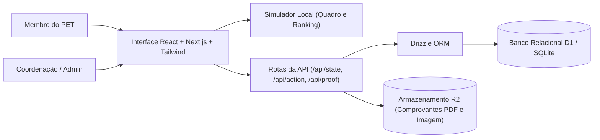

# Gamificação PET · Protótipo de pontuação e validação de entregas

**Ambiente de teste e validação das regras de tarefas, conferência cruzada e ranking mensal para grupos acadêmicos.**

Este repositório apresenta o protótipo funcional (**pontua.**) concebido para testar e validar como deve funcionar o controle mensal de atividades de um grupo PET (Programa de Educação Tutorial) com 16 integrantes. O sistema simula o fluxo completo entre quadro de tarefas, envio de comprovantes, revisão por pares da coordenação, rateio de pontos em entregas coletivas e fechamento de ciclo mensal.

[Produto](#o-produto) · [Minha contribuição](#minha-contribuição-e-uso-de-ia) · [Arquitetura](#arquitetura) · [Execução local](#executar-localmente) · [Demonstração](#roteiro-de-demonstração) · [Estado e limites](#estado-e-próximos-passos)

## O problema

Em grupos acadêmicos que realizam atividades contínuas de ensino, pesquisa, extensão e organização interna, acompanhar a participação de cada integrante costuma depender de planilhas manuais. Sem critérios objetivos de pontuação, exigência de comprovantes e revisão por outra pessoa, surgem distorções: tarefas complexas recebem o mesmo peso de ações simples, entregas em grupo geram dúvidas na divisão de pontos e o fechamento mensal torna-se subjetivo.

Este projeto modela e coloca à prova as regras operacionais antes da adoção definitiva pelo grupo, permitindo simular entregas, testar travas de governança e visualizar o impacto das regras no ranking mensal com dados fictícios.

## O produto

| Experiência | Recursos presentes no protótipo |
| --- | --- |
| **Quadro interativo e simulação** | Visão em colunas (*A fazer*, *Em andamento*, *Em revisão*, *Concluído*), filtro por categorias (`ENSINO`, `PESQUISA`, `EXTENSÃO`, `ORGANIZAÇÃO`), checklists, comentários, alternância de perfil ativo e recálculo imediato do ranking |
| **Gestão de entregas e comprovantes** | Registro de atividades vinculadas ao catálogo de tarefas, envio de comprovantes via link HTTPS ou arquivo privado (PDF/imagem até 10 MB), histórico do ciclo e pedido de novas tarefas |
| **Coordenação e governança** | Fila de validação de entregas, aprovação, devolução para ajuste, rejeição fundamentada, análise de contestação única, abertura de prazo de validação, fechamento de mês e trilha de auditoria |

### Fluxos e regras de negócio testadas

- **Pontuação fixa por complexidade:** cada tarefa possui nível definido no catálogo — Fácil (`5 pts`), Média (`15 pts`) ou Difícil (`30 pts`) — com limite de repetição e vigência por ciclo.
- **Proibição de autoaprovação:** a autorização no servidor e no quadro impede que um integrante aprove ou valide a própria entrega, mesmo que faça parte da coordenação.
- **Rateio em atividades em grupo:** quando uma entrega envolve mais de uma pessoa, o sistema destina `50%` dos pontos ao responsável principal e divide os `50%` restantes igualmente entre os demais participantes, exigindo a descrição da entrega individual de cada um.
- **Contestação com segundo revisor:** atividades rejeitadas admitem uma única contestação, que obrigatoriamente deve ser julgada por um membro da coordenação diferente daquele que aplicou a rejeição inicial.
- **Ciclo mensal em fases:** cada mês percorre os estados de teste/aberto (`test` / `open`), janela de validação com prazo limite (`validation`) e encerramento (`closed`), congelando a pontuação e separando pontos aprovados de pontos pendentes.

## Decisões de engenharia

| Desafio | Abordagem | Evidência no código |
| --- | --- | --- |
| Simular o comportamento do sistema sem expor dados reais | Espaço de trabalho populado com 16 integrantes fictícios e tarefas acadêmicas (`PET-001` em diante) com cálculo dinâmico de pontuação e critérios de desempate | [Modelo e simulação do quadro](components/quadro/model.ts) e [aplicação principal](components/quadro/app.tsx) |
| Garantir imparcialidade na conferência de entregas | Regra explícita impedindo autoaprovação tanto na movimentação de cartões quanto na rota de validação e julgamento de recursos | [Regras da API](app/api/action/route.ts) e [validação de transição](components/quadro/model.ts) |
| Modelar rateio proporcional e histórico imutável | Gravação de *snapshot* de dificuldade/pontos no momento da aprovação e tabela dedicada de participações com fração (`share`) por membro | [Esquema Drizzle/SQLite](db/schema.ts) e [persistência de participantes](app/api/action/route.ts) |
| Armazenar comprovantes com validação de formato e tamanho | Rota dedicada para recebimento e leitura de arquivos PDF, PNG, JPEG ou WebP de até 10 MB no bucket de armazenamento | [Rota de comprovantes](app/api/proof/route.ts) |
| Rastrear alterações administrativas e fechamento de mês | Registro de eventos na tabela `audit` e processamento em lote (*batch*) ao encerrar o prazo de validação mensal | [Ações e auditoria](app/api/action/route.ts) e [estado consolidado](app/api/state/route.ts) |

## Minha contribuição e uso de IA

No desenvolvimento deste protótipo, combinei **Pen.dev** e **Codex** como ferramentas de apoio para transformar as regras de pontuação e governança discutidas para o grupo PET em uma aplicação navegável com persistência relacional. Minha contribuição concentrou-se em especificar as restrições do domínio, conduzir as decisões arquiteturais e validar os casos de borda da competição mensal:

- **Interface (`Pen.dev`):** estruturação visual do quadro de tarefas, das visões de ranking e dos modais de detalhes e revisão, organizando a experiência de uso em React e Tailwind CSS.
- **Escrita de código e revisão (`Codex`):** apoio na implementação das rotas de API, do esquema relacional em Drizzle ORM e na revisão técnica das validações de permissão, rateio de pontos e transições do ciclo mensal.
- **Decisões e validação (Autor):** definição das regras de negócio que evitam distorções no ranking — como bloquear autoaprovação, limitar repetições de tarefas, exigir um segundo avaliador em recursos e separar pontos pendentes de pontos confirmados — e verificação prática simulando os perfis de `Membro`, `Coordenação` e `Administrador`.

## Arquitetura



A aplicação combina um ambiente interativo em React/Next.js para experimentação imediata do fluxo de trabalho com rotas de API conectadas ao banco relacional via **Drizzle ORM** (`members`, `months`, `tasks`, `activities`, `participations`, `task_requests`, `appeals` e `audit`) e armazenamento de objetos para comprovantes.

| Camada | Tecnologias |
| --- | --- |
| Interface | React 19, Next.js 16 (Vinext), TypeScript, Tailwind CSS 4, Radix UI / Base UI, Recharts e Lucide Icons |
| API e execução | Route Handlers (`app/api/`), Cloudflare Workers (Wrangler) e validação no servidor |
| Dados e arquivos | Cloudflare D1 (SQLite), Drizzle ORM, Drizzle Kit e Cloudflare R2 |

```text
app/
  api/
    state/route.ts       Carregamento do estado do mês, ranking, tarefas e permissões
    action/route.ts      Regras de negócio: entregas, validação, recursos e fechamento mensal
    proof/route.ts       Upload e leitura de arquivos comprobatórios no R2
  gestao/                Visão de gerenciamento e histórico administrativo
  page.tsx               Entrada principal da aplicação
components/
  quadro/
    app.tsx              Orquestração do protótipo interativo
    model.ts             Regras de pontuação, estágios, permissões e dados de simulação
    screens.tsx          Visões de ranking, catálogo, membros e acompanhamento
    task-details.tsx     Modal de detalhes da tarefa, checklist e comentários
  ui/                    Componentes visuais reutilizáveis
db/
  schema.ts              Esquema relacional completo em Drizzle ORM
  index.ts               Conexão com o banco D1
drizzle/                 Migrações SQL geradas e metadados do esquema
```

## Executar localmente

### 1. Instalar as dependências

Utilize Node.js 22.13 ou superior. Na raiz do repositório:

```bash
git clone https://github.com/Felipecoder07/gameficacao-pet.git
cd gameficacao-pet
npm ci
```

### 2. Gerar migrações e iniciar o ambiente de desenvolvimento

```bash
npm run db:generate
npm run dev
```

Para executar com o runtime local do Wrangler (simulando os *bindings* locais de D1 e R2 em `.wrangler/state`):

```bash
npm run build
npm start
```

> No PowerShell, caso a política de execução bloqueie `npm.ps1`, utilize `npm.cmd` no lugar de `npm`.

## Roteiro de demonstração

Como o objetivo deste repositório é demonstrar e validar o funcionamento do modelo de gamificação, uma apresentação pode seguir cinco passos:

1. **Visão geral e ranking:** apresentar o quadro de atividades (`PET-001` a `PET-012`) e mostrar como o ranking separa pontos já concluídos dos pontos que ainda estão na coluna *Em revisão*.
2. **Troca de perfil e trava de governança:** alternar entre um perfil de `Membro` e um de `Coordenação`, demonstrando que ninguém consegue aprovar uma atividade na qual está listado como participante.
3. **Pontuação em grupo:** abrir uma tarefa com mais de um responsável e mostrar o cálculo automático de rateio (`50%` para o líder e `50%` dividido entre os demais participantes).
4. **Fluxo de revisão e contestação:** explicar o caminho de uma entrega enviada com comprovante, a possibilidade de devolução ou rejeição motivada e a exigência de um segundo coordenador para julgar contestações.
5. **Fechamento mensal:** demonstrar a transição do mês entre o modo de teste (`test`), a janela de validação com prazo final (`validation`) e o congelamento do histórico (`closed`).

## Estado e próximos passos

Este repositório representa um **ambiente de teste e validação funcional** do sistema. Nenhum dado real de integrantes foi inserido na base versionada.

Antes de transformar o ciclo de teste em operação oficial do grupo, as próximas etapas incluem:
- Definir em conjunto com o grupo a regra definitiva de desempate (atualmente o sistema utiliza a quantidade de tarefas difíceis como segundo critério visual) e a política de retenção dos dados.
- Configurar o provedor de autenticação institucional para acesso individual dos 16 membros cadastrados por e-mail.
- Automatizar alertas para entregas pendentes de revisão há mais de três dias.

---

Projeto no portfólio de [Felipe · Felipecoder07](https://github.com/Felipecoder07).
